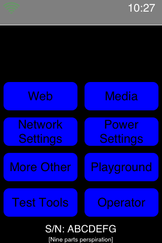

# SkankPhone en qemu-ios (iPod touch 1G emulado)

Ejecuta **SkankPhone**, la app interna de Apple del prototipo de iPhone OS **1A420** (marzo de 2007),
dentro del emulador [qemu-ios](https://github.com/devos50/qemu-ios) (iPod touch 1G, iPhone OS 1.1 / 3A101a),
en Windows 11 con WSL (Debian) + WSLg.

SkankPhone no es una app normal: en el prototipo hacía de **shell del sistema** (no había SpringBoard).
Aquí se lanza con launchd en lugar de SpringBoard y funciona: menú principal, táctil, navegador con los
marcadores de 2007 y sus tests internos.

## Contenido

| Ruta | Qué es |
|---|---|
| [`PROCESO.md`](PROCESO.md) | **Documentación completa**: cada paso, decisiones y 17 fallos con causa y solución |
| `Panel iPod.exe` · [`panel/`](panel) | Panel de control (WinForms): reinicio rápido (F5), Home, Reposo, capturas, log |
| [`scripts/ctl.py`](scripts/ctl.py) · [`scripts/arrancar.sh`](scripts/arrancar.sh) | Control y arranque del emulador desde WSL |
| [`scripts/build/`](scripts/build) | Scripts usados para construirlo todo (descargas, compilación, inyección en HFS+, parche de SpringBoard, análisis Mach-O…) |
| [`qemu-multitouch.patch`](qemu-multitouch.patch) | Parche de qemu-ios para que la emulación del táctil no tumbe QEMU |
| `capturas/` | Capturas de cada fase |

## Qué NO incluye este repositorio

Ningún binario de Apple: ni el volcado 1A420, ni los frameworks, ni el SpringBoard parcheado, ni bootrom/iBoot,
ni las imágenes NOR/NAND. Todo eso se descarga o genera con los scripts de `scripts/build/`
(ver `PROCESO.md`) y vive en WSL en `~/iternalipod/`.

## Requisitos

- Windows 11 con WSL2 (distro `Debian`) y WSLg
- Las rutas están fijadas a `F:\Descargas\iternalipod` (Windows) y `~/iternalipod` (WSL); si usas otras, ajústalas en
  `scripts/arrancar.sh`, `scripts/ctl.py` y `panel/PanelIPod.cs`

## Créditos

- [devos50/qemu-ios](https://github.com/devos50/qemu-ios) y [qemu-ios-generate-nand](https://github.com/devos50/qemu-ios-generate-nand) (Martijn de Vos y colaboradores)
- Guía original de SkankPhone: [Purpleproject](https://purplepro123.github.io/Purpleproject/Views/SkankPhone.html) (gracias a Stonneph)
- [xpwn](https://github.com/planetbeing/xpwn) (planetbeing) y [dmg2img](https://github.com/Lekensteyn/dmg2img)
